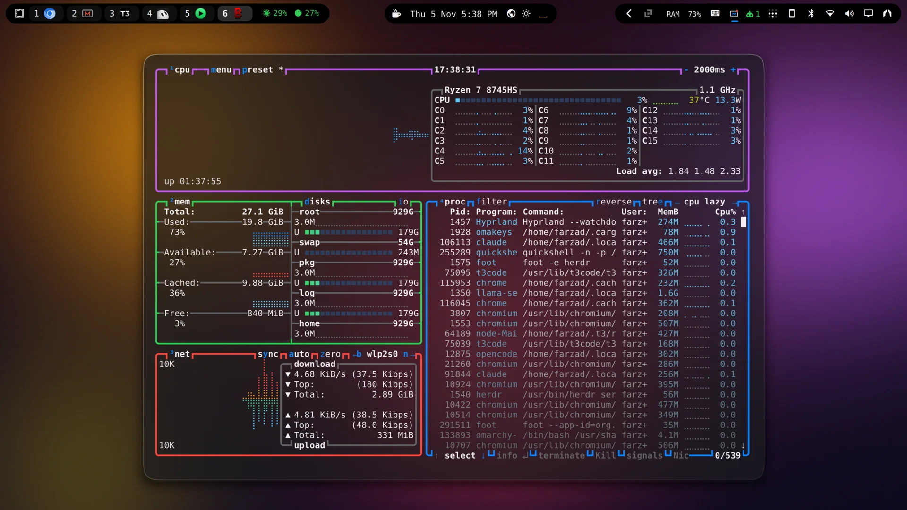
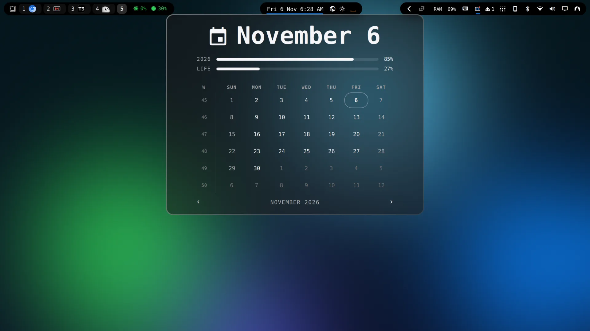
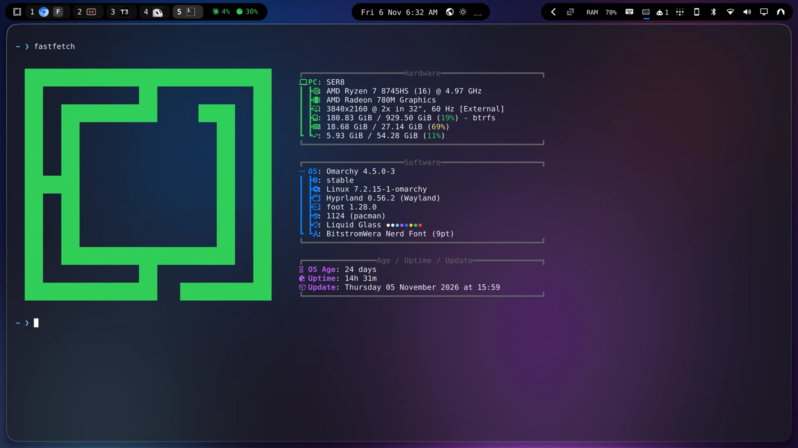

# Liquid Glass

[](https://github.com/tcballard/omarchy-badges)

An Apple Liquid Glass style theme for [Omarchy](https://omarchy.org): frosted see-through windows, a floating island top bar, soft squircle corners, and a thin light-catching rim.







## Install

```bash
curl -fsSL https://raw.githubusercontent.com/FarzadHayat/omarchy-liquid-glass-theme/main/install.sh | bash
```

Why not `omarchy theme install`? For a theme cloned from git, Omarchy only keeps colors, images and shell styling. It drops `hyprland.lua` and the terminal configs, and those carry the blur, rounding, rim and see-through terminals. The installer clones the repo to `~/.local/share/omarchy-liquid-glass-theme` and links it into your themes folder, so Omarchy uses all of it.

Want colors and wallpapers only, without the glass effects or the island bar? That still works:

```bash
omarchy theme install https://github.com/FarzadHayat/omarchy-liquid-glass-theme
```

## Uninstall

```bash
curl -fsSL https://raw.githubusercontent.com/FarzadHayat/omarchy-liquid-glass-theme/main/uninstall.sh | bash
```

This switches you to Tokyo Night if Liquid Glass is active (add `-s -- <theme>` after `bash` to pick another), brings back the stock bar, and removes the theme, the island bar and its update hooks. It also removes a copy installed with `omarchy theme install`.

## What you get

- A floating island top bar: the left, center and right sections become separate capsules, frosted in the Glassy bar style and solid black in Opaque, like a dynamic island
- Frosted blur behind see-through windows, the bar, menus, notifications and the OSD
- 16px squircle corners, a 1px white gradient rim, and a soft floating shadow
- Terminals (Alacritty, Foot, Kitty, Ghostty) at 70% opacity
- Apple dark mode system colors, `Yaru-blue-dark` icons
- Three blurred color wallpapers, each with a matching 5 second intro video

## The island bar

The installer adds an island version of the Omarchy bar. It is built on your machine from your own stock bar plus a small patch ([`bar/islands.patch`](bar/islands.patch)), so it matches your Omarchy version.

- The islands only show while Liquid Glass is active. On any other theme the bar looks like the stock one.
- After `omarchy update`, and at login, a hook rebuilds it from the new stock bar. If an update changes the bar too much for the patch, you get the stock bar back and a notification. Re-run the install line once the theme is updated.
- If you already run your own bar clone, the installer leaves it alone and skips the islands.
- It replaces the bar while installed. Uninstalling restores the stock bar.

## Palette

| Role | Hex |
|------|-----|
| Background | `#1c1c1e` |
| Foreground | `#f5f5f7` |
| Accent / Blue | `#0a84ff` |
| Red | `#ff453a` |
| Orange | `#ff9f0a` |
| Yellow | `#ffd60a` |
| Green | `#30d158` |
| Cyan | `#64d2ff` |
| Magenta | `#bf5af2` |

## Backgrounds

- `1-liquid-aurora.webp`
- `2-liquid-lagoon.webp`
- `3-liquid-ember.webp`

Cycle with Super + Ctrl + Space.

## Appearance settings

Omarchy's Appearance settings apply on top of the theme. Best look: keep Window Transparency on Transparent and Window Corners on Theme.

- **Window Transparency, Glassy:** Replaces the theme's blur with a lighter, darker one, so the frost gets thinner. Terminals keep their 70% opacity.
- **Window Transparency, Opaque:** Does not make the terminals solid, since they set their own opacity. Edit the terminal config for that.
- **Window Corners, Sharp or Rounded:** Replace the 16px squircle corners.
- **No-animations mode (on by default in VMs):** Also turns off blur and shadows, so the glass look is lost.

## Performance

The blur costs a little GPU while the screen is changing, and next to nothing at idle. On a Radeon 780M at 4K, idle GPU use went from about 1.5% with no blur to about 4% with this theme.

## More for Omarchy

See everything else I've built for Omarchy, each with a one-line install, at **[omarchy.farzadhayat.dev](https://omarchy.farzadhayat.dev)**.
